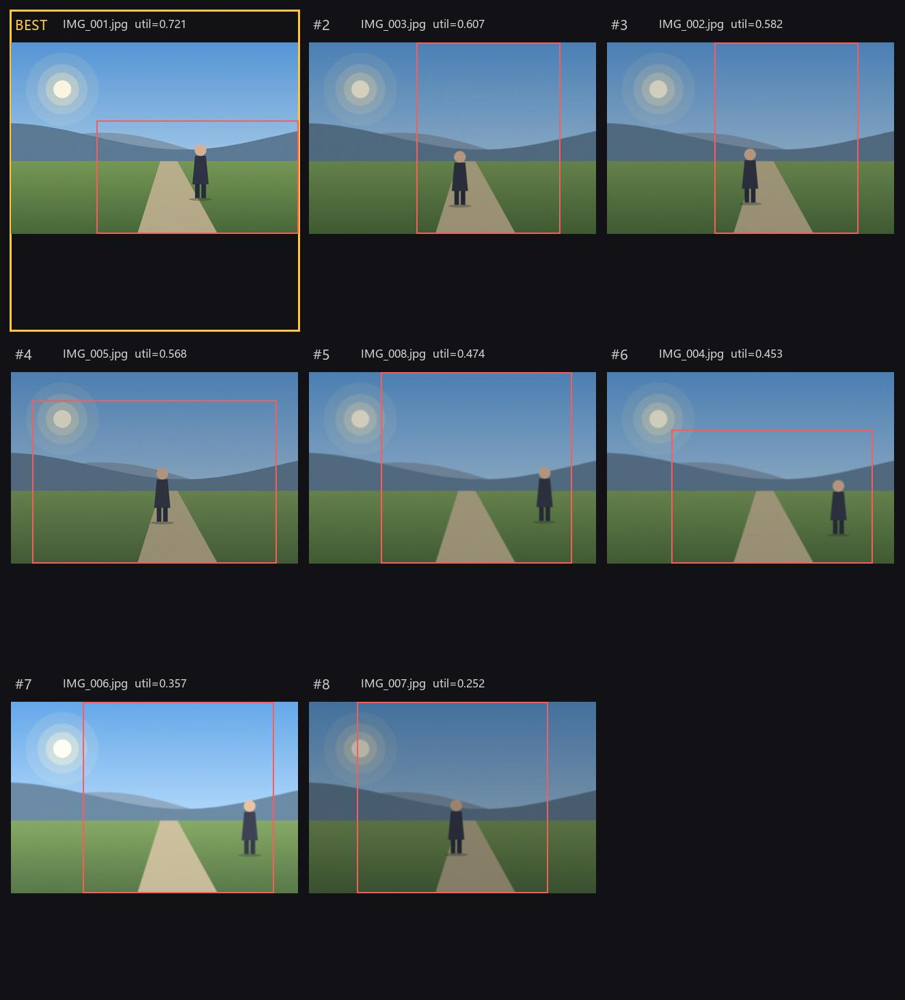

# FramePick · 智能选片系统

> 机器视觉课程大作业（2026 期中）— 给定同一场景拍摄的一组照片，自动选出最具美感、最值得保留的一张，并给出**最优取景框**与可解释理由。

  

---

## 1. 问题一句话

同一场景连拍的一组照片差异极小（构图微移、表情/姿态变化、曝光抖动、轻微失焦），**绝对美学分数会失效**——它们几乎打出相同的分。因此我们把任务定义为**组内相对排序**（within-series relative ranking），并在此之上引入**取景框优化**：不仅选哪张，还选"怎么框"。

## 2. 系统流程

```
一组同场景照片
      │
      ▼
① 预处理      去重 / EXIF 校正 / 长边归一化 / 清晰度-曝光快速筛查
      │
      ▼
② 候选生成    全图 + 主体框外扩 + 三分法对齐网格 + 多尺度多宽高比滑窗 → NMS
      │
      ▼
③ 候选评价    技术质量 ‖ 美学模型 ‖ 构图规则 ‖ 多模态大模型语义打分
      │
      ▼
④ 融合与排序  特征融合 w·φ → Bradley-Terry / LambdaRank 组内排序 → Top-1 (+Top-K 备选)
      │
      ▼
⑤ 输出        最佳照片 + 取景框 + 分数拆解 + 自然语言理由
```

## 3. 快速开始

```bash
python -m venv .venv && source .venv/bin/activate     # Windows: .venv\Scripts\activate
pip install -e .            # 安装为可编辑包（也可用 pip install -r requirements.txt + PYTHONPATH=src）

# 生成一组合成演示图（无需任何数据集）
python scripts/make_demo_data.py

# 跑完整流程，输出排序结果与拼图
python scripts/run_demo.py --input data/sample/series_01 --out outputs/demo

# 或者用 Web 界面
python app/gradio_app.py
```

命令行：

```bash
framepick --input data/sample/series_01 --out outputs/run01 --topk 3
# 未安装时等价写法：PYTHONPATH=src python -m framepick.cli --input ... 
```

输出示例（`outputs/run01/result.json`）：

```json
{
  "series": "series_01",
  "best": {
    "file": "IMG_003.jpg",
    "crop": [82, 140, 1132, 844],
    "scores": {"quality": 0.71, "aesthetic": 0.64, "composition": 0.83, "semantic": 0.70},
    "utility": 0.72,
    "reason": "主体完整且位于右三分线，背景留白充足，焦点锐利，无高光溢出。"
  },
  "ranking": [["IMG_003.jpg", 0.72], ["IMG_007.jpg", 0.68], ["IMG_001.jpg", 0.55]]
}
```

## 4. 效果预览

在合成连拍上跑出来的联系表（红框为算法给出的最优取景框，黄框为 BEST）：



系统输出示例（`outputs/run01/result.json`）：

```json
{
  "series": "series_01",
  "best": {
    "file": "IMG_001.jpg",
    "crop": [307, 279, 1024, 682],
    "utility": 0.721,
    "scores": {"quality": 0.714, "aesthetic": 0.573, "composition": 0.710, "subject": 0.592},
    "reason": "组内最优：主体居中、画面稳定，焦点锐利，曝光正常，主体完整未被裁断。"
  },
  "ranking": [["IMG_001.jpg", 0.721], ["IMG_003.jpg", 0.607], ["IMG_002.jpg", 0.582]]
}
```

## 5. 目录结构

```
framepick/            核心库
  candidates.py       候选取景框生成（多尺度 + 构图先验 + NMS）
  features.py         技术质量 / 构图 / 显著性特征（纯 numpy）
  saliency.py         谱残差显著性（Hou & Zhang, 2007）
  scorers/            评分器：heuristic / nima / clip-aesthetic / vlm
  fusion.py           特征融合（可学习权重）
  ranker.py           Bradley-Terry 偏好排序 + 评价指标
  pipeline.py         端到端流水线
  cli.py              命令行入口
scripts/              演示数据、跑通脚本、训练排序器
app/                  Gradio 演示界面
tools/label_tool.py   本地组内偏好标注小工具（零依赖 HTTP 服务）
docs/                 设计报告与图表
tests/                单元测试
```

## 6. 设计报告

完整调研与方案见 [`docs/设计报告.md`](docs/设计报告.md)，PDF 版本 [`docs/设计报告.pdf`](docs/设计报告.pdf)（含问题定义、四条技术路线调研、系统设计、数据与实验计划、分工与排期）。

重新生成报告：

```bash
python scripts/build_report.py    # Markdown → HTML → PDF（用本机 Chrome 无头打印）
```

## 7. 当前进度（期中）

| 模块 | 状态 |
| --- | --- |
| 候选生成 + 构图先验 | ✅ 可运行 |
| 技术质量 / 构图 / 显著性特征 | ✅ 可运行 |
| 融合与组内排序（Bradley-Terry） | ✅ 可运行 |
| NIMA / CLIP-IQA 美学打分 | 🚧 适配器已写，待接权重 |
| 多模态大模型打分与理由 | 🚧 适配器已写，待接 API Key |
| 自建 SeriesSet 标注 | 🚧 标注工具已就绪，待采集 |

## 8. 团队

| 角色 | 姓名 | 学号 |
| --- | --- | --- |
| 组长 | 蒋锦宏 | 202493006 |
| 组员 | 张满 | 202493002 |
| 组员 | 章丞轩 | 202493001 |

## 9. 许可

MIT License，见 [LICENSE](LICENSE)。
