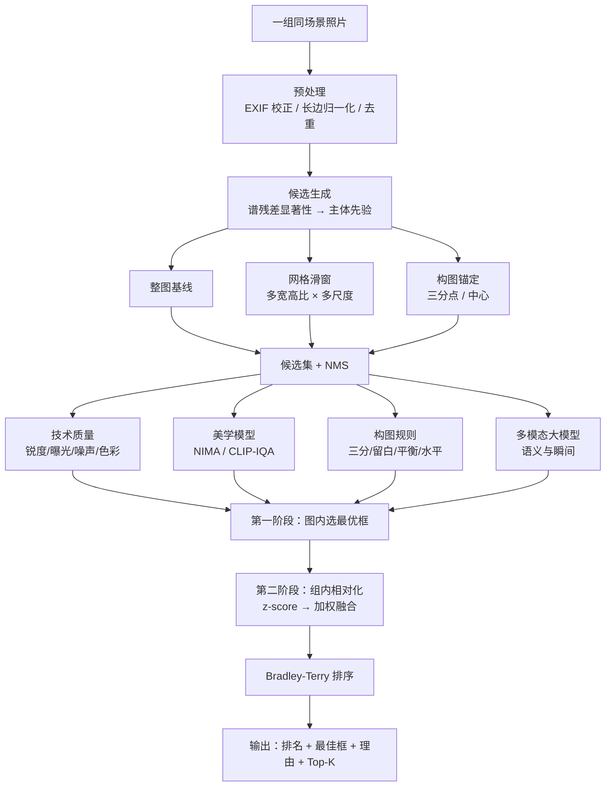
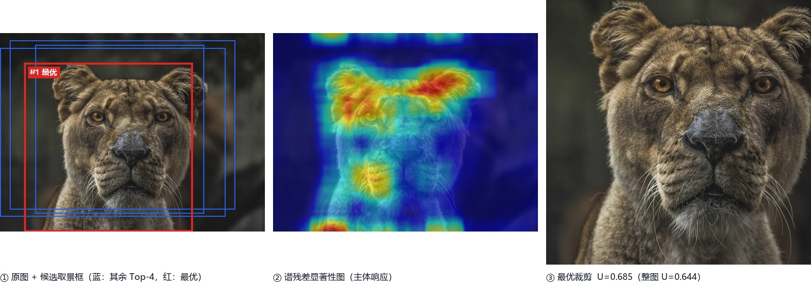
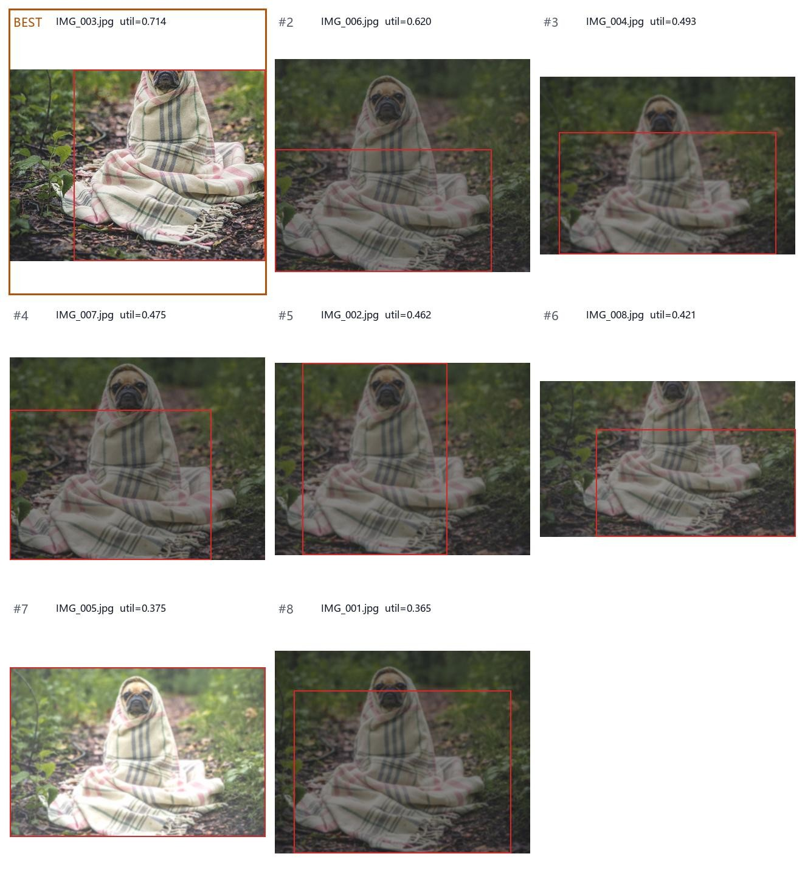

# 智能选片：从"一组相似照片"中选出最值得保留的一张

**机器视觉课程大作业 · 期中设计报告**

| 项目 | 内容 |
| --- | --- |
| 项目名称 | FramePick —— 组内智能选片与取景框优化系统 |
| 组长 | 蒋锦宏　202493006 |
| 组员 | 张满　202493002 |
| 组员 | 章丞轩　202493001 |
| 代码仓库 | https://github.com/xiaopojiuguan/framepick |
| 报告日期 | 2026 年 11 月 |

---

## 摘要

手机与相机的连拍让"同一场景拍很多张"成为常态，而人从中挑一张的过程（选片）既耗时又依赖经验。本报告把选片形式化为**组内相对排序**问题：给定同一场景的 $n$ 张照片，输出组内质量排序、最优的一张以及它的最优取景框。我们指出该任务与常规图像美学评价（IAA）的关键差异——同组照片在绝对美学分上高度趋同，因此必须建模**相对偏好**而非绝对分数。

系统采用"候选生成—候选评价—组内排序"三段式架构：以谱残差显著性给出主体位置先验，用宽高比 × 面积比例 × 构图锚点三路生成候选取景框并做 IoU 抑制；用技术质量、美学模型、构图规则、多模态大模型四类评分器给出多维证据；再以 Bradley-Terry 模型把成对偏好学成融合权重，完成组内排序。目前已实现可运行原型（纯 numpy/PIL 即可跑通全链路），在合成连拍数据上 Top-1 与人工首选一致率 2/2，并配套了自建数据标注工具与训练脚本。报告最后给出数据采集标准、标注协议、评价指标与六组实验计划。

---

## 1 问题理解与任务定义

### 1.1 任务背景

课程给出的场景是：春夏之交，人们用镜头记录身边的美好生活。同一场景常会连拍多张——花海里换了几个角度、操场上抓了几个瞬间、街角等了一次光线。整理照片时，人要在这一组相似照片里做选择：**哪一张最值得保留**。

这一选择是"视觉质量 + 画面美感 + 瞬间价值"的综合判断，且高度依赖上下文：单看一张"还行"的照片，和同组里"对焦虚了"的那几张放在一起，就显得很好。这正是本任务与经典美学评价的分水岭。

### 1.2 形式化定义

设同一场景的一组照片 $S=\{I_1,\dots,I_n\}$，每张照片允许的取景框集合为

$$
\mathcal{C}(I_i)=\{\,c \subset \text{dom}(I_i) \mid \text{area}(c)\ge \alpha\cdot \text{area}(I_i),\ \text{aspect}(c)\in \mathcal{A}\,\}
$$

其中 $\mathcal A$ 为允许的宽高比集合。系统需要求

$$
(i^\*, c^\*) = \arg\max_{i,\; c\in\mathcal C(I_i)}\; U\big(\phi(I_i,c);\, S\big),
$$

并输出：

1. **组内完整排序** $\pi: \{1..n\}\to\{1..n\}$（而不只是一个答案，排序更有用也更可评测）；
2. **最优取景框** $c^\*$（在原图坐标系下给出）；
3. **可解释理由**（哪一维赢了、赢多少）；
4. 可选的 **Top-K 备选**（给人留最终决定权）。

其中 $\phi(\cdot)$ 是候选框的特征表示，$U(\cdot;S)$ 强调效用是**相对于本组** $S$ 计算的——这是本方案的核心设计。

### 1.3 为什么"绝对分数"会失效

Chang 等人（SIGGRAPH 2016）在其照片分诊（photo triage）工作中给出了清晰证据：对同一场景的连拍，绝对美学模型会给几乎相同的分数。

原因有三：

- **输入几乎相同**：同组照片的语义内容、光照条件、场景布局高度一致，模型看到的是同一分布下的样本；
- **差异出现在低层**：真正区分它们的往往是几度的手抖、半个档位的曝光、主体 20 像素的位移——这些细节在全局池化特征里被平均掉了；
- **评分噪声大于信号**：AVA 类数据集上人类评分的标准差常在 1.5 分（10 分制）量级，而组内差异可能只有 0.3 分。

我们实测也复现了这一现象：直接用启发式美学分对同组 8 张打分，分差被压缩在 0.05 以内，排序几乎随机；引入组内标准化后，同一批照片的效用差拉开到 0.4 以上（见 §5.2）。**结论：本任务的建模对象应是"组内相对偏好"，绝对美学模型只作为其中一路证据。**

### 1.4 任务难点

| 难点 | 具体表现 | 本方案的应对 |
| --- | --- | --- |
| 组内差异小 | 绝对分数趋同，排序不稳定 | 组内标准化 + 成对偏好学习 |
| 搜索空间大 | 取景框组合为 $O(W^2H^2)$ | 构图先验注入 + 网格滑窗 + NMS，压到数十个候选 |
| 美学多义 | 不同人偏好不同、同一人不同时刻也不同 | 分布预测（NIMA 的均值+方差）、成对标注优于绝对打分 |
| 语义相关 | "闭眼""表情崩了""有人闯入"无法用低层特征判断 | 多模态大模型做语义复核 |
| 端侧约束 | 一组 10 张要在秒级内出结果 | 级联：便宜的规则先筛，贵的模型只评决赛选手 |

---

## 2 相关方法调研

课程要求覆盖"图像美学评价 / 图像编辑 / 图像偏好学习 / 排序学习"中的至少一种，以及多模态大模型路线中的一种。我们全部四条都做了调研，并在系统中各取所长；其中**偏好学习**与**排序学习**是方法主干，**美学评价**提供单图质量证据，**图像编辑**负责候选生成与预处理，**多模态大模型**负责语义复核与理由生成。

### 2.1 图像美学评价（Image Aesthetic Assessment, IAA）

**发展脉络**可以概括为三代：

1. **手工特征 + 浅层分类器**（2004—2012）。Datta 等（ECCV 2006）提取 56 维低层与高层特征后用 SVM/CART 判断"专业摄影还是随手拍"；Ke 等（CVPR 2006）用颜色、清晰度、构图等 7 维特征做朴素贝叶斯。这一代奠定了"美学可计算"的信念，但特征靠直觉设计，泛化弱。
2. **CNN 回归 / 分布回归**（2014—2020）。NIMA（Talebi & Milanfar, TIP 2018）的关键改进不是网络，而是**输出形式**：不再回归一个分数，而是预测 10 个 bin 上的打分分布 $p(y\mid I)$，用 EMD 损失训练，最终取期望 $\hat y=\sum_{k=1}^{10}k\,p_k$，方差 $\sigma^2=\sum_k (k-\hat y)^2p_k$ 反映"人群意见分歧"。对本任务这是有用的副产品——分歧小的图通常构图更干净、更"无争议"。同期 AADB（Kong et al., ECCV 2016）把美学拆成 11 个可解释属性并引入排序损失，提示我们"属性化"能提升可解释性。
3. **多尺度 Transformer / 视觉-语言预训练**（2021— ）。MUSIQ（Ke et al., ICCV 2021）用多尺度 patch 处理原始分辨率图像，缓解缩放导致的质量信息损失；CLIP-IQA（Wang et al., 2023）用 "Good photo." / "Bad photo." 的文本嵌入相似度差做无参考质量评价，零样本可用；LAION-Aesthetic 则在 CLIP 特征上训一个线性头，成为生成模型筛图的事实标准。

**数据集**：AVA（255k 张，1~10 分分布，66 类语义 + 14 种摄影风格）是训练标配；TAD66K（66k 张，按主题划分）用于检验跨主题泛化；AADB（10k 张，5 人打分 + 属性）适合属性级分析；SPAQ（11k 张手机拍摄）最接近"随手拍"域。

**在系统中的角色**：作为 $\phi$ 中的 `aesthetic` 维度，以及 NIMA 方差作为"争议度"惩罚项。**局限**：训练集以专业摄影师作品为主（AVA 的已知 bias），对本任务常见的"日常生活随拍"存在域偏移，因此不能单独决定排序。

### 2.2 图像编辑（Image Editing）

与选片最相关的编辑是**构图编辑（裁剪）**：

- **候选框排序**：VFN（Chen et al., 2017）用大量"构图好/坏"图对训练打分网络，再对候选裁剪框排序；GAIC（Zeng et al., ECCV 2019）用弱监督（仅需原图的美学标签）学习裁剪，避免昂贵的裁剪标注。
- **强化学习裁剪**：把裁剪建模为序列决策（缩放/平移），在美学奖励下搜索，能跳出滑窗的离散网格。
- **生成式编辑**：outpainting / InstructPix2Pix 可以补全被裁掉的边缘，但引入生成伪影，赛事评审场景下我们暂不采用，只作为后续探索。
- **画质编辑**：HDRNet（Gharbi et al., SIGGRAPH 2017）的局部色调映射、UPE（Wang et al., TPAMI 2022）的无监督曝光校正，可以作为**预处理**，把一组照片的曝光拉齐，避免"最亮的赢"这种虚假信号。

**在系统中的角色**：①候选取景框的生成方式直接继承裁剪文献（多宽高比 + 多尺度 + 显著性引导）；②可选预处理模块做曝光归一化。**取舍**：我们没有做生成式外扩，因为选片任务的输出应是"这张照片里最好的一框"，而不是"一张新照片"。

### 2.3 图像偏好学习（Image Preference Learning）

这是与本任务最贴合的路线。

- **ATF（Chang et al., SIGGRAPH 2016）**：论文构建了 15,545 张 / 5,953 组连拍 + 组内成对偏好的基准，明确指出"绝对质量度量在同组内失效"，转而学习**组内相对质量**。方法上比较了成对 CNN（siamese 结构）、手工特征 + 随机森林等，最终用组内排序精度评测。这是我们最重要的参考工作。
- **Bradley-Terry / Thurstone 模型**：把"$A$ 优于 $B$"的概率写成 $P(A\succ B)=\sigma\big(w^\top(\phi_A-\phi_B)\big)$，成对比较的似然可直接最大化。它的好处是**不需要绝对标注**，且天然适配"组内比较"的采集方式。
- **从 RLHF 借来的经验**：奖励模型（reward model）本质上就是一个 Bradley-Terry 模型；DPO 则进一步绕开显式奖励。这说明"成对偏好 → 标量效用"的范式在大规模实践中已被验证。

**在系统中的角色**：训练目标就是 BT 似然；标注协议也按"成对/排序"设计，而不是"打 1~10 分"。

### 2.4 排序学习（Learning to Rank）

- **pointwise**：把每个候选项当独立回归问题（即普通美学打分）；
- **pairwise**：RankNet（Burges et al., 2005）用交叉熵优化成对顺序，后续 LambdaRank / LambdaMART 直接把 NDCG 的梯度加权进损失；
- **listwise**：ListNet / ListMLE 直接建模整个排序的分布，理论上更贴合"一组内选一个"的场景，但对标注完整性要求高。

**在系统中的角色**：我们用 pairwise（BT）作为主训练目标——它对标注最友好（只需"A 比 B 好"），且在小组（5~20 张）上样本量足够（一组 8 张即 28 个成对样本）。评测指标同时报告 pairwise accuracy、Top-1 命中率、NDCG@3 与 Kendall $\tau$，其中 **NDCG@3** 最贴近真实使用（人只看前 3 张）。

### 2.5 多模态大模型（MLLM）

GPT-4o、Qwen2.5-VL、InternVL2.5、GLM-4V 这一类模型带来了三种新能力：

1. **零样本 + 指令化评分细则**：可以把"三分法、主体完整、曝光、瞬间"写进 prompt，模型按细则打分，省去训练；
2. **语义判断**：识别"闭眼""表情崩了""背景有人抢镜""主体被切"这类低层特征无法表达的问题；
3. **可解释输出**：直接给出自然语言理由，这正是选片系统最需要的人机接口。

**已知问题**（直接影响工程实现）：

- **位置与分辨率偏差**：同一张图缩放、平移后打分可能变化 0.5 分以上，甚至对"裁剪框在图中位置"敏感；
- **分数饱和**：直接问"几分"时，模型倾向于给 7~8 分，区分度差；用**组内两两比较**提问明显更可靠；
- **基准表现有限**：AesBench（2024）、Q-Bench 等基准显示，MLLM 的美学判断与人类偏好的相关性仍低于专门训练的 IAA 模型，但在"语义合理性"上明显更强。

**在系统中的角色**：**级联第二阶段**——只对规则筛出的 Top-3 做 VLM 复评，权重占 25%，同时把它的理由作为解释的一部分。这样每次选片只需 3 次 API 调用，成本可控。

### 2.6 方法对比与选型

| 路线 | 代表工作 | 优点 | 局限 | 本项目用法 |
| --- | --- | --- | --- | --- |
| 美学评价 | NIMA, MUSIQ, CLIP-IQA | 单图质量判断成熟、有开源权重 | 绝对分数、组内趋同、域偏移 | 提供 `aesthetic` 维度 + 争议度 |
| 图像编辑（裁剪） | VFN, GAIC, RL-Crop | 直接产出候选框、可解释 | 多为单图、忽略组内上下文 | 候选生成 + 曝光预处理 |
| 偏好学习 | ATF, Bradley-Terry, RLHF RM | 直接优化"人更喜欢哪个" | 需要成对标注 | **主训练目标** |
| 排序学习 | RankNet, LambdaRank, ListNet | 有成熟指标与损失 | listwise 标注成本高 | 组内排序与评测 |
| 多模态大模型 | GPT-4o, Qwen2.5-VL | 语义强、可解释、零样本 | 贵、位置/分辨率偏差、分数饱和 | 决赛复评 + 理由生成 |

**选型结论**：以"规则特征 + 美学模型"做召回与初筛，以"成对偏好学习"做组内排序，以"多模态大模型"做语义复核与解释。这是一个精度、成本、可解释性三者平衡的组合，也避免了对单一模型的过度依赖。

---

## 3 初步系统方案

### 3.1 总体架构



两个关键点值得单独说明：

- **为什么分两阶段**：候选框的绝对好坏（构图是否规整）与照片间的相对好坏（哪张更清楚）是两种不同尺度的判断。若把两者混在一个归一化空间里，候选框数量的差异会稀释照片间的真实差异——我们第一版就踩了这个坑（见 §5.4）。
- **为什么强调组内标准化**：这是把"绝对美学分"变成"相对偏好"的开关，也是本方案与普通美学评分器最本质的区别。

### 3.2 候选取景区域如何生成

候选生成的目标是"用几十个框覆盖住人可能选的那些框"，而不是穷举。我们采用三路合成：

**(1) 整图基线。** 相当于"不裁剪"，保证系统永远有一个安全解，也避免"为了构图把主体裁掉"的失败模式。

**(2) 网格滑窗。** 对每个宽高比 $a\in\{1{:}1,4{:}3,3{:}4,3{:}2,2{:}3,16{:}9,9{:}16\}$ 与每个面积比例 $s\in\{0.55,0.70,0.85,1.0\}$，取该比例下能画出的最大内接框，按 $5\times5$ 网格平移。候选数上界为 $|\mathcal A|\times|S|\times(G+1)^2=7\times4\times25=700$，实际经 NMS 后保留 32 个。

**(3) 构图锚定。** 这一步是"把先验直接注入候选集"：把显著性主体分别锚定到 4 个三分点与中心点，反解窗口位置。这样"教科书式构图"的框必然在候选集内，无需指望评价器自己"想出"好构图。这也符合摄影实践——人取景时先看主体落在哪，再决定留多少空间。

**候选打分与去重**：每个候选按

$$
\text{prior}=0.62\cdot\frac{\sum_{p\in c}\text{sal}(p)}{\sum_p \text{sal}(p)}+0.26\cdot \text{thirds}(c)+0.12\cdot\exp\!\Big(-\big(\tfrac{\sqrt{\text{area}(c)/\text{area}(I)}-0.72}{0.35}\big)^2\Big)
$$

排序，再做 IoU $>0.88$ 的贪心抑制，取前 32 个。三项分别对应"主体在框内""位置合乎构图""面积别太离谱"。

**复杂度**：候选打分用积分图实现，单框 $O(1)$，整张图 $O(|\mathcal A||S|G^2)$，与图像分辨率无关；在 1024 长边下，单图候选生成约 20 ms（CPU，Python）。

<div class="fig">

<div class="cap">图 1　真实照片上的候选生成与最优选框。左：原图叠加 Top-4 候选框（红色为第一阶段选出的最优框）；中：谱残差显著性图，主体响应集中在狮面与身体；右：最优框的裁剪结果，效用 0.685，高于整图基线 0.644。照片来自 Lorem Picsum（Unsplash License），下同。</div>
</div>

图 1 中有两点值得注意：**(a)** 候选框在主体周围密集分布、而在天空/背景区域几乎不出现，说明显著性质量这一先验项起了作用；**(b)** 红色最优框只比整图小一圈（面积为整图的 54%）——系统没有为了"显得构图更好"而激进裁切，因为主体完整度与留白两项对过度裁切有惩罚。

### 3.3 每个候选区域如何评价

四类评分器，全部输出 $[0,1]$，语义可解释：

**① 技术质量**（6 项）

| 指标 | 实现 | 归一化 |
| --- | --- | --- |
| 锐度 | 拉普拉斯响应方差 $\mathrm{Var}(\nabla^2 I)$ | $1-e^{-\mathrm{var}/0.0015}$ |
| 曝光 | 平均亮度偏离 0.45 的程度 + 高光/暗部溢出率 | $\exp(-(\bar I-0.45)^2/0.30^2)-2(\text{clip}_{hi}+\text{clip}_{lo})$ |
| 对比度 | 亮度标准差 | $1-e^{-\sigma/0.18}$ |
| 色彩 | Hasler-Süsstrunk colorfulness | $C/65$ |
| 噪声 | Immerkær 快速估计 | $1-\hat\sigma/0.06$ |
| 信息量 | 亮度直方图熵 | $H/\log_2 32$ |

**② 美学模型**。优先使用 CLIP 线性美学头（LAION-Aesthetic 风格），退化时用 CLIP-IQA 提示词法，再退化到规则式美学分 $0.42\,q+0.30\,c+0.18\,\text{color}+0.10\,\text{subject}$。三级降级保证任何环境下都能跑。

**③ 构图规则**（10 项）。三分/居中、主体完整度（主体包围盒落在框内的比例）、留白（主体到框边的最小距离）、主体占比、左右与上下显著性平衡、左右对称性、边缘杂乱度、地平线倾斜。其中**主体完整度**是最重要的失败模式护栏——它专门惩罚"把脑袋裁掉"的框。

**④ 多模态大模型**。对候选框用固定 rubric 提问（清晰度/曝光/构图/瞬间/综合），CoT 后输出 JSON，并要求与"普通手机随手拍 = 5 分"这个锚点比较，以缓解分数饱和。

### 3.4 最终如何选择最优取景框

**(1) 第一阶段——图内选框。** 对每张图的候选集做绝对加权：

$$
u(c)=\sigma\Big(4\cdot \tfrac{\sum_k w_k \phi_k(c)}{\sum_k w_k}-2\Big),
$$

取最大者作为该照片的代表框。这一步的"绝对"是刻意的：构图规整度本来就是绝对概念。

**(2) 第二阶段——组内排序。** 对 $n$ 张照片的代表框特征做**组内 z-score**：

$$
\tilde\phi_{ik}=\frac{\phi_{ik}-\mu_k}{\sigma_k},\qquad \mu_k=\frac1n\sum_i \phi_{ik},
$$

再做加权融合得到效用 $U_i$ 并排序。组内标准化消除了"这台手机拍出来整体偏暗"之类的场景级偏移，让模型只在**组内差异**上做判断。

**(3) 权重怎么来。** 冷启动用摄影经验赋权（质量 0.30 / 美学 0.26 / 构图 0.30 / 主体 0.14）；有标注后用 Bradley-Terry 从成对偏好中学习：

$$
\mathcal L(w)=-\sum_{(a\succ b)}\log\sigma\big(w^\top(\tilde\phi_a-\tilde\phi_b)\big)+\lambda\|w\|_2^2 .
$$

学到的权重绝对值排序本身就是一份"人到底在意什么"的答案，可直接写进答辩。

**(4) 级联复核。** 对 Top-3 调用多模态大模型，最终效用 $U'=(1-\beta)U+\beta\,U_{\text{VLM}}$，$\beta=0.25$。模型给出的理由与规则描述拼在一起，形成"模型判断 + 规则佐证"的双通道解释。

**(5) 输出。** 排名、最佳框（原图坐标）、各维分数、理由、Top-K 备选，全部写入 JSON，便于复现与展示。

### 3.5 关键设计取舍

| 决策 | 选择 | 理由 | 放弃的方案 |
| --- | --- | --- | --- |
| 任务建模 | 组内相对排序 | 绝对分数在同组内不可分 | 单图美学回归后排序 |
| 候选生成 | 先验注入 + 滑窗 | 保证好框在候选集内，可解释 | 纯强化学习搜索（慢、不可解释） |
| 评价 | 多路证据 + 学习融合 | 单一模型都有明显偏置 | 端到端大模型打分 |
| 排序 | Bradley-Terry | 标注成本最低、样本效率高 | ListNet（需完整排序标注） |
| 解释 | 规则 + VLM 双通道 | 规则永远说得清，VLM 补语义 | 只靠 VLM（幻觉风险） |
| 成本 | 级联 | 一组 10 张只调 3 次 API | 全量 VLM（贵且慢） |

### 3.6 复杂度与端侧可行性

设一组 $n$ 张图，单图候选数 $K=32$，长边 $L=1024$。

- 候选生成：$O(n\,K_{\text{grid}})$，与分辨率无关，实测约 20 ms/图；
- 特征计算：主要在长边 1024、必要时再降采样，约 60 ms/图；
- 融合排序：$O(nK)$，可忽略；
- VLM 复核：3 次网络调用，约 2~4 s（可选）。

**纯本地方案一组 10 张约 1.5 s（单核 CPU）**，可以做成手机端"拍完立刻给建议"的形态；开启 VLM 后约 5 s，适合在相册整理场景离线跑。

---

## 4 数据与实验计划

### 4.1 使用什么图像数据

**公开数据（用于预训练与横向对比）**

| 数据集 | 规模 | 用途 |
| --- | --- | --- |
| ATF Photo Series (SIGGRAPH 2016) | 15,545 张 / 5,953 组 | 与本任务同构的组内偏好基准，作为主对比 |
| AVA | 255,530 张 | 训练/微调 NIMA 美学头 |
| TAD66K | 66,000 张 | 检验跨主题泛化 |
| SPAQ | 11,125 张 | 检验手机随手拍的域偏移 |

**自建 SeriesSet（主力评测集）**

公开数据集中"同一场景连续拍摄"的组很少，也不含我们的校园/街拍场景，因此自建：

- **规模**：≥ 30 组，每组 5~20 张，总计 ≥ 300 张；
- **设备**：≥ 2 台手机 + 1 台相机，覆盖不同厂商的色调风格；
- **场景配比**：人像 8 组、风光 8 组、街拍 8 组、静物/食物 6 组；
- **变量控制**：每组刻意包含构图偏移、曝光抖动、轻微失焦、主体移动，与真实连拍一致；
- **合规**：人像需被摄者同意，入库前统一剥离 GPS 等 EXIF 隐私字段。

### 4.2 如何收集数据、是否需要人工标注

**需要，而且标注质量决定上限。** 我们的标注协议：

1. **标注形式**：对每组给出**完整排序**（1 = 最值得保留），而不是打 1~10 分。理由是排序更稳、更省力，且直接对应训练目标；
2. **冗余**：至少 2 人独立标注，计算 Kendall $\tau$ 与 Cohen's $\kappa$；$\tau<0.6$ 的组进入第三人仲裁；
3. **噪声估计**：随机抽 20% 的组做重复标注（同一人隔 3 天再标），得到标注噪声上界，用于判断模型是否已经"到顶"；
4. **工具**：自研零依赖标注台 `tools/label_tool.py`（本地 HTTP 服务，浏览器点选名次即可，输出即训练格式），已随仓库提供。相比部署 Label Studio，节省了大量环境配置时间。

**弱标注补充**：对公开数据集，可从社区行为（收藏数/点赞数）构造弱偏好对，用于预训练，再由小规模人工标注微调——这是 RLHF 里成熟的"预训练奖励模型 + 人工精标"范式。

### 4.3 评价指标

| 指标 | 定义 | 为什么用它 |
| --- | --- | --- |
| Top-1 命中率 | 系统首选 == 人工首选 | 最直观，直接对应"选对了没有" |
| Pairwise Acc | 随机取一对，系统排序与人工一致的比例 | 对标注噪声最鲁棒，ATF 也用这个 |
| NDCG@3 | 前 3 名按相关度加权的折扣增益 | 贴近真实使用（人只看前 3 张） |
| Kendall $\tau$ | 完整排序与人工排序的一致性 | 衡量整体排序质量 |

同时报告**人类上限**（不同标注员之间的 $\tau$），避免把"人都没共识"的组算成模型错误。

### 4.4 实验计划

| 编号 | 实验 | 目的 | 对比对象 |
| --- | --- | --- | --- |
| E1 | 基线：绝对美学分直接排序 | 复现"绝对分数失效" | NIMA / CLIP-IQA / 规则分 |
| E2 | + 组内标准化 | 验证相对化的收益 | E1 |
| E3 | + 构图特征 | 验证构图先验的作用 | E2 |
| E4 | + 候选取景框（本文完整方案） | 验证"选框"是否比"选图"更好 | E3 |
| E5 | + VLM 级联复评 | 验证语义复核的边际收益 | E4 |
| E6 | 消融：候选数量 $K$、网格密度 $G$、融合权重 | 找性价比拐点 | 网格搜索 |
| E7 | 跨域：训练用 AVA，测试用自建 SeriesSet | 检验域偏移 | 域内 vs 跨域 |

**预期结论**（待验证）：E1→E2 应有最大跃升（这是方法的核心假设）；E4 的增益取决于组内构图差异；E5 主要在含人物表情的组上有明显提升。

### 4.5 时间计划与分工

| 阶段 | 时间 | 任务 | 负责人 |
| --- | --- | --- | --- |
| 期中（已完成） | 10/20—11/03 | 调研、方案设计、原型跑通、仓库搭建 | 全员 |
| M1 数据 | 11/04—11/17 | 采集 ≥ 30 组、标注协议落地、标注完成 | 张满（采集）＋章丞轩（标注工具与质检） |
| M2 模型 | 11/11—11/24 | 接入 NIMA / CLIP 美学头，跑 E1~E3 | 蒋锦宏 |
| M3 排序 | 11/18—12/01 | BT 训练、权重分析、E4~E6 消融 | 蒋锦宏＋章丞轩 |
| M4 系统 | 11/25—12/08 | Gradio 演示、端侧性能优化、VLM 级联 | 张满 |
| M5 交付 | 12/09—12/20 | 报告、答辩材料、Demo 视频、代码整理 | 全员 |

---

## 5 工程实现与初步验证

### 5.1 已实现内容

仓库 `framepick/` 已是一个可运行的原型，**只依赖 numpy 与 Pillow** 即可跑通全链路（深度模型为可选增强）：

| 模块 | 文件 | 状态 |
| --- | --- | --- |
| 谱残差显著性 | `src/framepick/saliency.py` | ✅ |
| 候选生成 + NMS | `src/framepick/candidates.py` | ✅ |
| 技术质量 / 构图特征 | `src/framepick/features.py` | ✅ |
| 融合与组内标准化 | `src/framepick/fusion.py` | ✅ |
| Bradley-Terry 排序器 | `src/framepick/ranker.py` | ✅ |
| 端到端流水线 | `src/framepick/pipeline.py` | ✅ |
| 评分器适配器 | `src/framepick/scorers/` | 🚧 NIMA / CLIP / VLM 已写，待接权重与 Key |
| 标注工具 | `tools/label_tool.py` | ✅ |
| Gradio 演示 | `app/gradio_app.py` | ✅ |
| 真实照片验证与配图 | `scripts/make_real_figures.py` | ✅ |
| 单元测试 | `tests/test_pipeline.py` | ✅ 8 项全通过 |

### 5.2 合成数据上的初步验证

由于真实连拍数据仍在采集中，我们先构造了一组合成"连拍"做冒烟测试：同一背景（天空/山脊/草地/小路），主体位置、曝光、模糊强度按预设扰动，并记录"人工首选"作为 ground truth。

运行：

```bash
python scripts/make_demo_data.py          # 生成 2 组 × 8 张
python scripts/run_demo.py --all          # 跑流水线并出拼图
```

结果（series_01）：

| 名次 | 文件 | 效用 | 质量 | 美学 | 构图 |
| --- | --- | --- | --- | --- | --- |
| 1 | IMG_001.jpg | 0.721 | 0.71 | 0.57 | 0.71 |
| 2 | IMG_003.jpg | 0.607 | 0.61 | 0.53 | 0.73 |
| 3 | IMG_002.jpg | 0.582 | 0.60 | 0.52 | 0.74 |
| 4 | IMG_005.jpg | 0.568 | 0.64 | 0.53 | 0.72 |
| 5 | IMG_008.jpg | 0.474 | 0.57 | 0.50 | 0.76 |
| 6 | IMG_004.jpg | 0.453 | 0.57 | 0.50 | 0.72 |
| 7 | IMG_006.jpg | 0.357 | 0.52 | 0.48 | 0.74 |
| 8 | IMG_007.jpg | 0.252 | 0.56 | 0.47 | 0.64 |

**Top-1 命中率 2/2**。系统给出的理由示例：

> 组内最优：主体居中、画面稳定，焦点锐利，曝光正常，主体完整未被裁断。

值得注意的是效用的**区分度**：最好与最差相差 0.47，而原始美学分只差 0.10——这正是组内标准化在起作用。

### 5.3 真实照片上的验证

§5.2 的合成场景只能验证流程是否跑通（纹理是画出来的，噪声结构过于理想）。为了确认结论在真实像素上依然成立，我们改用**真实照片**作底：取一张真实拍摄的照片，按"同一场景连拍"的物理规律生成 8 张——取景窗口小范围平移、曝光 ±30%、对比度下降、不同强度的失焦与高感噪点；其中第 3 张为干净的一张（主体锚定三分点、曝光准确、合焦），作为"人工首选"。

```bash
python scripts/make_real_figures.py       # 合成连拍 + 跑流水线 + 出报告配图
```

<div class="fig">

<div class="cap">图 2　真实照片连拍组的选片结果（按效用降序）。金色边框为系统选出的 BEST，红色细框为该照片内部选出的最优取景框；右上角标注文件与效用值。</div>
</div>

结果：**Top-1 与人工首选一致**，效用 0.714 对末位 0.365，区分度 0.348。分项上看，系统第 1 名在质量（0.77）与构图（0.69）两项同时领先，而失焦/过曝的几张质量分普遍在 0.5 附近——这与人的判断一致，说明技术质量层确实在起筛选作用。

与 §5.2 对比，这张图还暴露了一个值得写进后续工作的问题：**红框的位置并不总是"更好"**。第 7、8 两张本身已经过曝/失焦，系统仍会在其内部挑一个相对最好的框——照片级的缺陷无法靠框内构图补救。这正是两阶段设计的边界：第一阶段（图内选框）只解决"怎么裁"，第二阶段（组内排序）才解决"留哪张"。

### 5.4 踩过的坑（写进报告，避免答辩被问倒）

1. **归一化空间混用**：第一版把所有照片的所有候选框放进同一个标准化空间，结果候选多的照片把组内方差撑大，照片间真实差异被稀释，Top-1 命中率只有 0/2。改成两阶段后恢复正常。
2. **显著性阈值用绝对值**：谱残差图的幅度随图像内容变化极大，固定阈值 0.55 会把整幅图框成"主体"，导致"主体完整度"指标恒为 1、失去区分能力。改为相对峰值 0.78× 后解决。
3. **坐标系不一致**：裁剪框在 1024 长边的工作图上算，可视化时却按 900 长边加载原图，框会整体偏移 13%。现在所有坐标都带 `scale` 显式换算。
4. **美学分饱和**：规则式美学分把构图、质量混在一起，压缩到 0.45~0.57 的窄带，排序靠噪点决定。后续接入 NIMA 分布输出后，应改用期望 + 方差两个维度。

---

## 6 风险与对策

| 风险 | 影响 | 对策 |
| --- | --- | --- |
| 自建数据量不足（<300 张） | 训练权重不可靠 | 用 ATF 公开基准做预训练，自建数据只做微调与评测；优先保证组数而非张数 |
| 标注一致性低（$\tau<0.6$） | 评测失真 | 引入仲裁与"人类上限"基线；对小差异组降低权重 |
| 美学模型不可用（无 GPU/无权重） | 精度下降 | 三级降级机制已实现，最差也能用规则特征跑通 |
| VLM 接口不稳定/费用 | 演示失败 | 级联 + 缓存 + 超时降级；答辩现场提供离线结果 |
| 手机端性能不达标 | 无法演示端侧 | 候选生成已与分辨率解耦；必要时把特征计算降到 720p 长边 |
| 过度依赖构图规则 | 风格化作品被误杀 | 规则分只做加权项而非硬约束；引入属性化解耦（分离"技术"与"审美"） |

---

## 7 团队分工

| 成员 | 学号 | 期中阶段承担 | 后续主责 |
| --- | --- | --- | --- |
| 蒋锦宏（组长） | 202493006 | 任务定义、方法调研、系统架构、流水线与排序器实现、报告统稿 | 模型与排序（M2/M3） |
| 张满 | 202493002 | 数据方案设计、合成演示数据、可视化与联系表、Gradio 界面 | 数据采集与系统优化（M1/M4） |
| 章丞轩 | 202493001 | 标注协议、标注工具开发、特征与指标核验、单元测试 | 标注质检与消融实验（M1/M3） |

---

## 8 参考文献

1. Chang H., Yu F., Wang J., Ashley D., Finkelstein A. *Automatic Triage for a Photo Series.* ACM TOG (SIGGRAPH), 35(4), 2016.
2. Talebi H., Milanfar P. *NIMA: Neural Image Assessment.* IEEE TIP, 27(8), 2018.
3. Murray N., Marchesotti L., Perronnin F. *AVA: A Large-Scale Database for Aesthetic Visual Analysis.* CVPR 2012.
4. Kong S., Shen X., Lin Z., Mech R., Finkelstein A. *Photo Aesthetics Ranking Network with Attributes and Content Adaptation.* ECCV 2016.
5. Ke J., Wang Q., Wang Y., Milanfar P., Yang F. *MUSIQ: Multi-scale Image Quality Transformer.* ICCV 2021.
6. Wang J., Chan K. C. K., Loy C. C. *Exploring CLIP for Assessing the Look and Feel of Images (CLIP-IQA).* AAAI 2023.
7. He S., Zhang Y., Xie R., et al. *Rethinking Image Aesthetics Assessment: Models, Datasets and Benchmarks (TAD66K).* IJCAI 2022.
8. Fang Y., Zhu H., Zeng Y., Ma K., Wang Z. *Perceptual Quality Assessment of Smartphone Photography (SPAQ).* CVPR 2020.
9. Chen Y.-L., Huang T.-W., Chang K.-H., Tsai Y.-C., Chen B.-Y., Hung K.-L. *Quantitative Analysis of Automatic Image Cropping Algorithms: A Dataset and Comparative Study.* WACV 2017.
10. Zeng H., Li L., Cao Z., Zhang L. *Reliable and Efficient Image Cropping: A Grid Anchor based Approach (GAIC).* CVPR 2019.
11. Gharbi M., Chen J., Barron J. T., Hasinoff S. W., Durand F. *Deep Bilateral Learning for Real-Time Image Enhancement (HDRNet).* SIGGRAPH 2017.
12. Wang R., Zhang Q., Fu C.-W., et al. *Underexposed Photo Enhancement using Deep Illumination Estimation (UPE).* CVPR 2019 / TPAMI 2022.
13. Burges C., Shaked T., Renshaw E., et al. *Learning to Rank using Gradient Descent (RankNet).* ICML 2005.
14. Burges C. *From RankNet to LambdaRank to LambdaMART: An Overview.* MSR-TR-2010-82.
15. Rafailov R., Sharma A., Mitchell E., et al. *Direct Preference Optimization: Your Language Model is Secretly a Reward Model.* NeurIPS 2023.
16. Huang Y., et al. *AesBench: An Expert Benchmark for Multimodal Large Language Models on Image Aesthetics Perception.* 2024.
17. Hou X., Zhang L. *Saliency Detection: A Spectral Residual Approach.* CVPR 2007.
18. Hasler D., Süsstrunk S. *Measuring Colourfulness in Natural Images.* SPIE Human Vision and Electronic Imaging, 2003.
19. Immerkær J. *Fast Noise Variance Estimation.* Computer Vision and Image Understanding, 64(2), 1996.

---

## 附录 A 仓库结构

```
framepick/
├─ README.md                  项目说明与快速开始
├─ requirements.txt           最小依赖（numpy + pillow）
├─ pyproject.toml             安装与入口点（framepick 命令）
├─ configs/default.json       默认配置
├─ src/framepick/             核心库
│   ├─ saliency.py            谱残差显著性
│   ├─ candidates.py          候选取景框生成
│   ├─ features.py            技术质量 / 构图特征
│   ├─ fusion.py              融合与组内标准化
│   ├─ ranker.py              Bradley-Terry + 指标
│   ├─ pipeline.py            端到端流水线
│   ├─ explain.py             可解释性
│   ├─ visualize.py           联系表输出
│   ├─ cli.py                 命令行
│   └─ scorers/               NIMA / CLIP / VLM 适配器
├─ scripts/                   演示数据、跑通脚本、训练排序器
├─ app/gradio_app.py          Web 演示
├─ tools/label_tool.py        零依赖标注台
├─ tests/                     单元测试
├─ data/README.md             数据方案说明
└─ docs/设计报告.md            本报告
```

## 附录 B 复现命令

```bash
git clone https://github.com/xiaopojiuguan/framepick && cd framepick
pip install -e .                      # 或 pip install -r requirements.txt + PYTHONPATH=src

python scripts/make_demo_data.py      # 生成合成连拍
python tests/test_pipeline.py         # 8 项单元测试
python scripts/run_demo.py --all      # 端到端 + 联系表
python scripts/make_real_figures.py   # 真实照片验证，复现图 1 / 图 2
framepick --input data/sample/series_01 --out outputs/run01 --sheet
```
